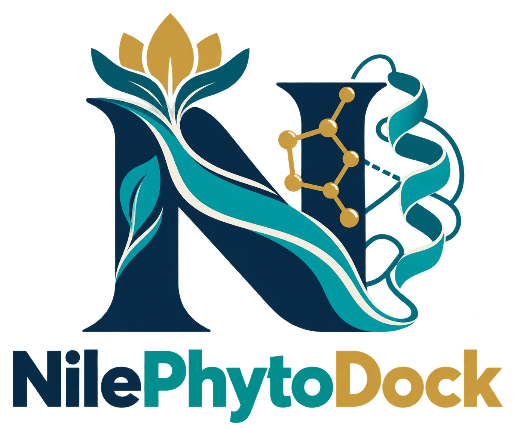
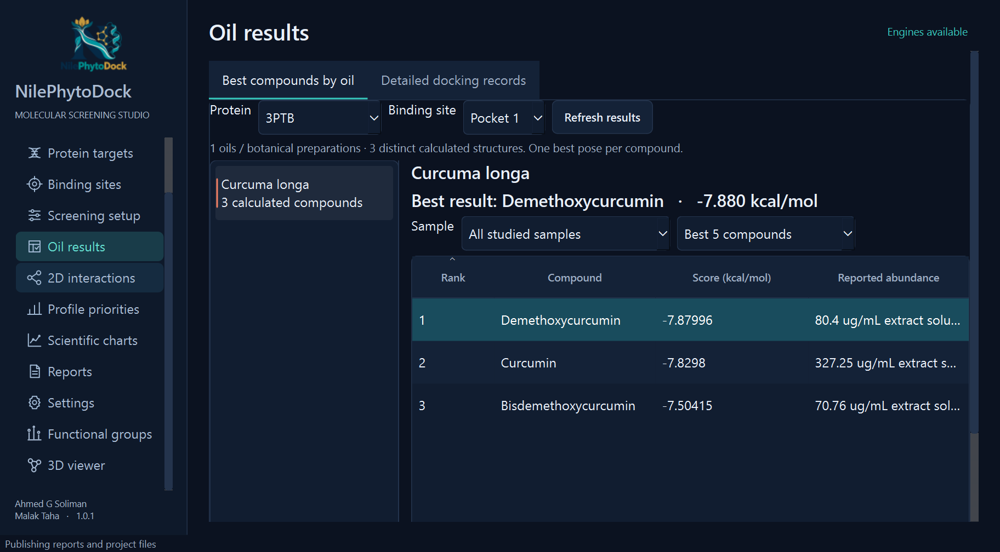
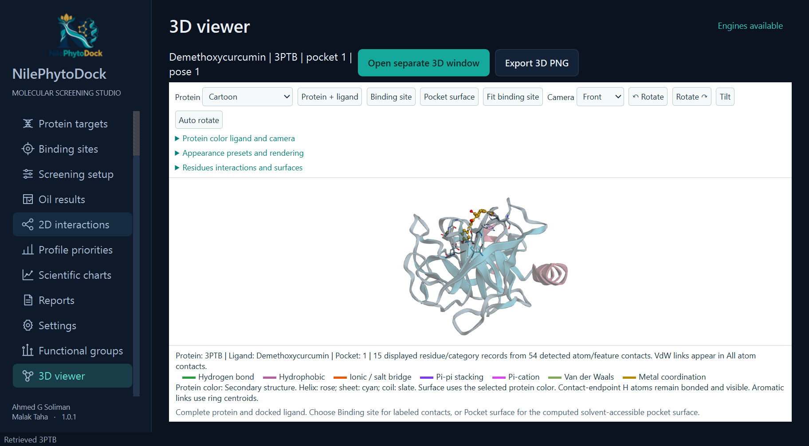
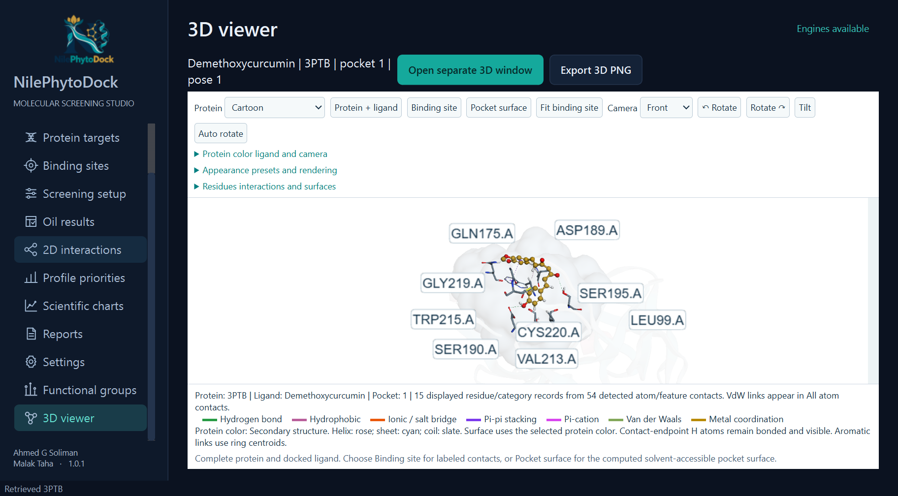
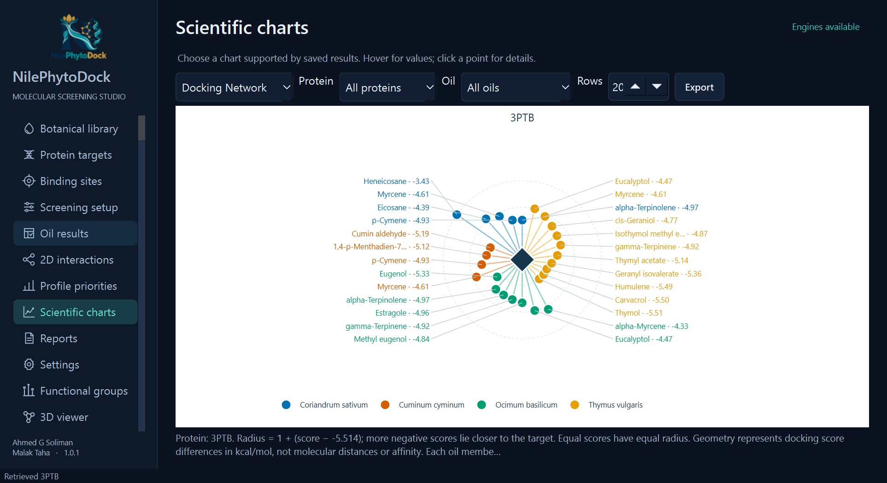
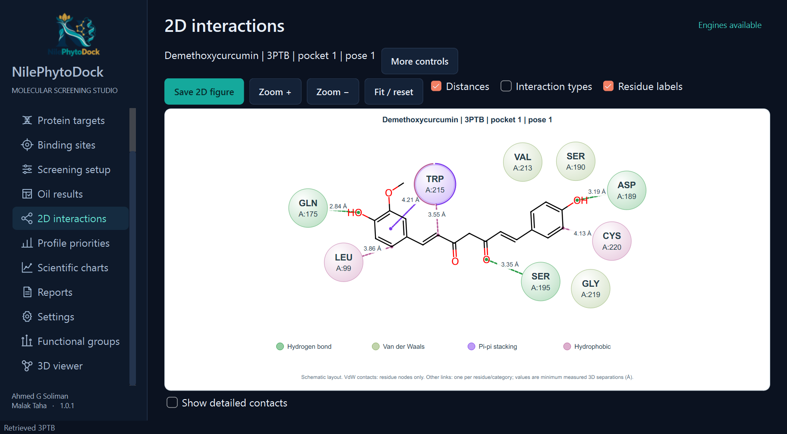
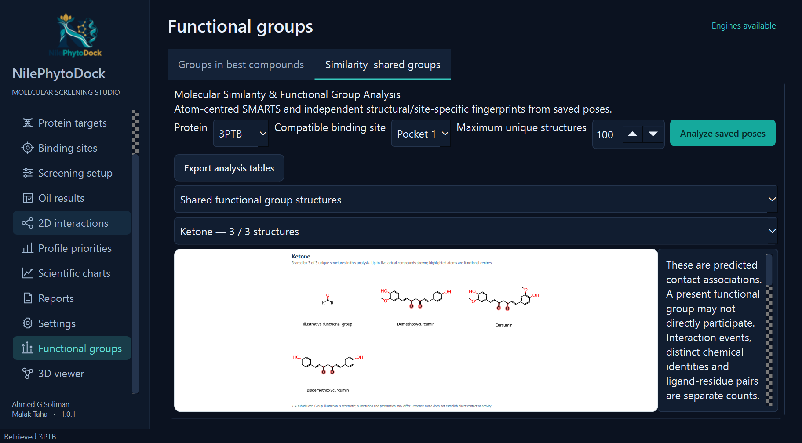

<h1 align="center">NilePhytoDock Studio v1.0.1</h1>

Local molecular screening for botanical oil research.

NilePhytoDock Studio brings source-aware botanical profiles, binding-site prediction, docking and molecular interpretation into an English Windows desktop workspace. Calculations run locally with the included scientific engines.

**One setup download.** Python, Qt, Java, P2Rank, Smina and the scientific libraries are included. Install, launch and choose your research output folder.

## Research capabilities

- Review the existing botanical library and its analytical sources, original units and structure-readiness information.
- Prepare protein targets, predict pockets with P2Rank and dock eligible compounds with Smina.
- Review each oil's best calculated compounds and the functional groups represented among top compounds for a selected protein.
- Retrieve validated PDB/mmCIF coordinates from IDs or structure links.
- Save atom-anchored 2D interaction figures, choose 3D camera angles and export readable high-resolution labels.
- Draw shared functional groups with highlighted examples from actual calculated compounds; use an independent full-screen 3D window.
- Compare results using **Bubble Plot**, **Docking Heatmap**, **Interaction Matrix** and a score-scaled **Docking Network**, with selected-chart loading and numerical exports.
- Export reports, figures, molecular structures and reproducibility records, and reopen saved studies.

## Inside the application

Actual screenshots from NilePhytoDock Studio v1.0.1 using verification studies; these are not interface mockups.

## Windows requirements

Windows 10/11 **x64**; 8 GB RAM recommended; 4 GB free space plus research outputs; a 1366 × 768 or larger display and working graphics drivers recommended. No manual Python, Java or scientific-library installation is required. Internet access is required for optional online PDB retrieval and maintenance. The English user guide is installed in the external **Documentation** folder.

**Current release:** v1.0.1. The first official public release remains v1.0.0. The download is unsigned; use the release checksum to verify it.

## Developers

**Ahmed G Soliman**  
**Malak Taha**

## Scientific and licensing notices

Docking scores and interaction analyses are computational predictions, not experimental binding affinities or evidence of whole-oil activity. Compare compatible receptor preparations and docking protocols, and review source coverage and analytical units.

NilePhytoDock source is **GPL-3.0-or-later**, without warranty. Third-party components retain their own licenses; mandatory notices are included in the installation. Cited publications and source data retain their authors' rights. [Licensing and corresponding source](https://github.com/ahmedGSoliman99/NilePhytoDock-Source) remain publicly accessible, including required dependency sources and rebuild instructions. This product page provides the Windows application; source access is maintained separately for license compliance.
